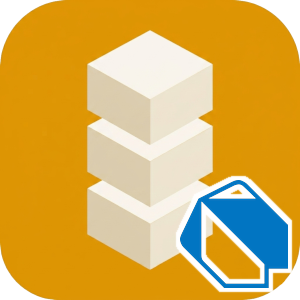

# Identisure Dart Client

[![pub.dev version][pub-image]][pub-url]
[![Documentation][docs-image]][docs-url]
[![MIT license][license-image]][license-url]

[pub-image]: https://img.shields.io/pub/v/identisure_client?style=flat-square
[pub-url]: https://pub.dev/packages/identisure_client
[docs-image]: https://img.shields.io/badge/github-docs-orange?logo=github&style=flat-square
[docs-url]: https://identisure.github.io/api-client-dart
[license-image]: https://img.shields.io/badge/license-MIT-blue?style=flat-square
[license-url]: https://opensource.org/license/mit

API client for the [Identisure](https://developers.identisure.com) REST API.

Documentation: [identisure.github.io/api-client-dart](https://identisure.github.io/api-client-dart)

## Requirements

Dart 3.4 or later.

## Supported providers

- **BankID SE**: auth, sign, phone auth and sign, QR verify, age verification
- **BankID NO**: auth, backchannel auth, sign, age verification
- **Freja eID**: auth, backchannel auth, sign, backchannel sign, age verification
- **MitID**: auth, backchannel auth, sign, age verification
- **FTN** (Finnish Trust Network): auth, age verification
- **Vipps MobilePay**: auth, backchannel auth
- **Documents**: upload and download documents for signing

## Installation

```sh
dart pub add identisure_client
```

## Usage

```dart
import 'package:identisure_client/identisure_client.dart';

Future<void> main() async {
  final client = IdentisureClientBuilder('client_id', 'client_secret')
      .environment(Environment.staging)
      .build();

  final session = await client.bankIdSe.auth(const BankIdSeAuthRequest());
  if (session is BankIdSePending) {
    print('Session ID: ${session.id}');

    final result = await client.bankIdSe.waitForAuth(session.id);
    final message = switch (result) {
      BankIdSeCompleted(:final name, :final ssn) => 'Authenticated: $name ($ssn)',
      BankIdSeFailed(:final error) => 'Failed: $error',
      BankIdSePending() => 'Still pending',
      BankIdSeUnknown(:final status) => 'Unknown status: $status',
    };
    print(message);
  }

  client.close();
}
```

### Verifying callbacks

Pass the raw request body exactly as received, before parsing it.

```dart
final valid = verifyCallbackSignature(rawBodyBytes, request.headers['x-signature-sha256']!, hmacSecret);
```

## Development

### Prerequisites

- Dart 3.4+

The tests load shared fixtures from a git submodule. Clone with `--recurse-submodules`, or run `git submodule update --init` in an existing clone.

### Build / Test / Analyze

```sh
dart pub get
dart test
dart analyze
```

### Release

Set the version in `pubspec.yaml` and `lib/src/transport.dart` and commit. Then push a tag:

```sh
git tag v0.1.0
git push origin v0.1.0
```

The release workflow checks that the tag matches the version, runs CI, publishes to pub.dev and creates a GitHub release.

## Other languages

[C#](https://github.com/identisure/api-client-csharp), [Go](https://github.com/identisure/api-client-go), [TypeScript/JavaScript](https://github.com/identisure/api-client-js), [Java/Kotlin](https://github.com/identisure/api-client-jvm), [PHP](https://github.com/identisure/api-client-php), [Python](https://github.com/identisure/api-client-py), [Ruby](https://github.com/identisure/api-client-ruby), [Rust](https://github.com/identisure/api-client-rust), [Swift](https://github.com/identisure/api-client-swift)
